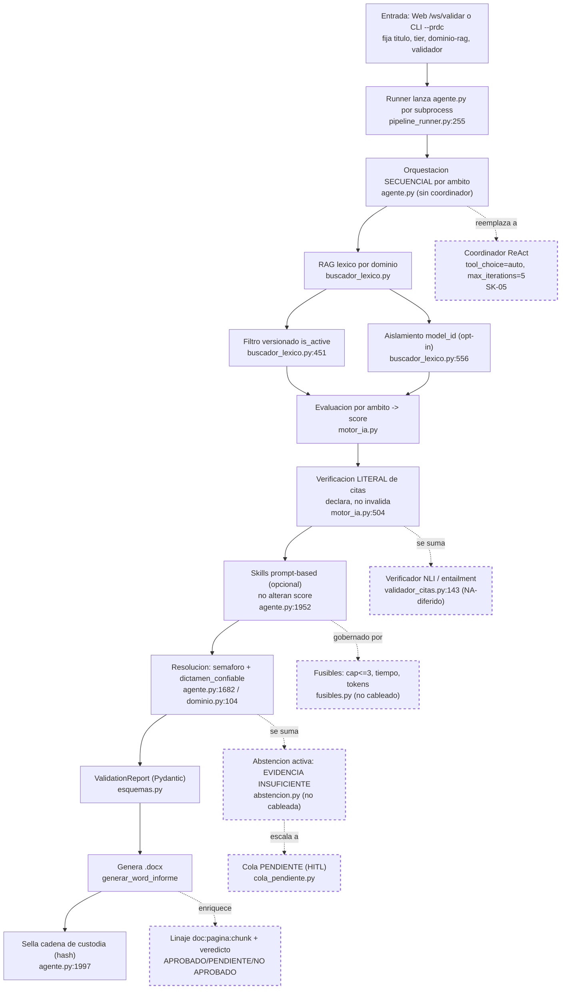

# FLUJO DEL AGENTE — VIRF Agent (extremo a extremo)

> **Qué es este documento.** Traza el recorrido completo de una validación, de la entrada
> hasta la entrega del `.docx` sellado, en las **4 fases** que pidió el validador: (a) cuándo
> se **dialoga** con el agente, (b) cuándo **replantea/autocorrige**, (c) cuándo **resuelve**
> —concluye o se abstiene—, (d) cuándo **entrega** el producto final.
>
> **Regla de honestidad.** El agente está **a medio construir**. Se distingue SIEMPRE entre:
> - **ACTUAL** — lo que ya corre hoy, con evidencia `archivo:línea` leída en el código.
> - **OBJETIVO** — lo que quedará cuando se encienda el **día de API** (coordinador ReAct +
>   skills tipadas + NLI + abstención cableada). Se marca como pendiente; **no se dibuja como
>   si existiera**.
>
> **Baseline git:** `caf3beb` (hito *Skills-1*). **API-free:** este documento no ejecutó
> ninguna corrida ni gastó crédito; toda afirmación ACTUAL está anclada a `archivo:línea`.
> Documento de solo lectura: no se modificó código de producción.

---

## 1. Resumen en prosa — las 4 fases

**(a) Cuándo se dialoga con el agente — ACTUAL.**
El diálogo es de **arranque**, no conversacional-agéntico. Una validación entra por dos bocas:
la **web** (el validador completa los pasos 1–8 del asistente y pulsa «Validar»; el navegador
abre un WebSocket `/ws/validar/{runId}` — [app.js:1669](web/static/js/app.js) — y el backend
lanza el CLI por subprocess — [pipeline_runner.py:255](web/services/pipeline_runner.py)), o el
**CLI directo** `python agente.py --prdc …` — [agente.py:305](agente.py). En ambos casos el
"diálogo" es la fijación de parámetros ANTES de gastar: título, tier, **dominio RAG declarado**
(`--dominio-rag`), validador(es) y estándar. Hay además un **chat post-informe** (`/ws/chat`,
[app.js:1227](web/static/js/app.js)) para preguntar sobre el resultado ya emitido. Lo que **no**
existe hoy es un bucle donde el agente pida aclaraciones a mitad de razonamiento: eso es OBJETIVO
(coordinador ReAct, día de API).

**(b) Cuándo replantea / autocorrige — HOY casi nada; es sobre todo OBJETIVO.**
Hoy la única "autocorrección" es de **contrato**: si el modelo devuelve un JSON inválido, se
reintenta el parseo un número acotado de veces (`INTENTOS_CONTRATO`, [parametros.py:254](config/parametros.py)),
y las citas se **verifican literalmente** pero solo se **declaran** dudosas, no se re-piensa la
respuesta ([motor_ia.py:513-515](modulos/motor_ia.py)). El "cambia de opinión" del enunciado —un
verificador que invalida una afirmación y fuerza un nuevo intento, con cap de iteraciones y
fusibles— está **construido pero NO cableado**: `fusibles.py` (`MAX_ITER=3`, `FUSIBLE_SEG=10`,
`FUSIBLE_TOKENS=20000`) existe, pero [parametros.py:264](config/parametros.py) admite que
activarlo "no altera nada" hoy porque **no hay bucle agéntico** que lo consuma. Ese bucle es
OBJETIVO (SK-05).

**(c) Cuándo resuelve — concluye (ACTUAL) o se abstiene (OBJETIVO parcial).**
El agente **concluye** hoy convirtiendo el score de cada ámbito en un **semáforo** de 5 niveles
(SATISFACTORIO → CRÍTICO, [dominio.py:104](config/dominio.py)) y un score global, más un flag
`dictamen_confiable` que baja si hubo fallos técnicos ([agente.py:1840-1843](agente.py)). La
**abstención activa formal** —responder «EVIDENCIA INSUFICIENTE» cuando el retrieval es débil,
con umbral β=0.19— está **implementada y probada** en [abstencion.py](modulos/abstencion.py),
pero **NO la invoca el pipeline `--prdc`**: hoy la falta de evidencia se refleja como
`sin_evidencia`/score 0.0 por actividad, no como un veredicto de abstención. Cablear β es OBJETIVO.

**(d) Cuándo entrega el producto final — ACTUAL.**
Al terminar los ámbitos (y, si se pidieron, las skills), el agente consolida un `payload` que se
valida contra el contrato Pydantic `ValidationReport` ([esquemas.py](modulos/esquemas.py)), genera
el informe **`.docx`** con [`generar_word_informe`](modulos/generador_word.py) y **sella la cadena
de custodia** por hash. Las skills corren **antes** del sellado a propósito, para que sus hallazgos
queden cubiertos por el hash ([agente.py:1857-1863](agente.py)). El `.docx` usa hoy la escala de
semáforo; la tríada formal **APROBADO/PENDIENTE/NO APROBADO** por ámbito es OBJETIVO.

---

## 2. Flujo ACTUAL (lo que corre hoy), paso a paso

Cada paso lleva su evidencia `archivo:línea`.

1. **Entrada y diálogo de arranque.**
   - Web: el asistente reúne sesión/modelo, estándares (paso 02, `estandares_service.parsear()`),
     upload/entendimiento y prompts; al validar, abre WS `/ws/validar/{runId}`
     ([app.js:1669](web/static/js/app.js)); el servidor lo atiende en
     [validacion.py:74](web/routers/validacion.py) y delega en el runner.
   - El runner **construye los args** y lanza `agente.py --prdc` por subprocess
     ([pipeline_runner.py:151-177, :255](web/services/pipeline_runner.py)), inyectando en el
     entorno el presupuesto de contexto del deployment y el override del rol si el validador lo
     editó ([pipeline_runner.py:69-110](web/services/pipeline_runner.py)).
   - CLI directo: `main()` con argparse ([agente.py:305](agente.py)). El **dominio RAG se declara**
     con `--dominio-rag`; sin el flag se **infiere por heurística del título** (que puede enrutar al
     corpus equivocado) — [motor_ia.py:180-189](modulos/motor_ia.py). El informe registra si el
     dominio fue *declarado* o *inferido*.

2. **Orquestación — secuencial, sin coordinador.**
   `agente.py` recorre los ámbitos, los evalúa y opcionalmente ejecuta skills, todo en orden fijo.
   Conviven dos pipelines: **Pipeline 1** por control de datos (`--control`, `motor/Mx_0x`) y
   **Pipeline 2** por ámbito ([motor_ia.py](modulos/motor_ia.py)), que es el que la web usa por
   defecto. `resultados_ambitos[ambito]` se va poblando por ámbito
   ([agente.py:1315](agente.py)).

3. **Recuperación de evidencia — RAG léxico por dominio.**
   Por actividad, `_enriquecer_con_rag` ([motor_ia.py:168](modulos/motor_ia.py)) consulta el
   índice del dominio (BM25 + TF-IDF, [buscador_lexico.py](src/rag/buscador_lexico.py)). Dos
   controles **nuevos y ya cableados** actúan dentro de `buscar`:
   - **Versionado**: `versionado.chunk_activo` descarta chunks marcados `is_active=False`
     (normativa derogada) — [buscador_lexico.py:451-463](src/rag/buscador_lexico.py).
   - **Aislamiento multi-tenant**: hard pre-filter **opcional** por `(tenant, model_id)`, adicional
     al de dominio, con aserción anti-contaminación — [buscador_lexico.py:556-565](src/rag/buscador_lexico.py).
     Es opt-in: si el llamante no pasa `model_id`, el comportamiento es el histórico.

4. **Evaluación por ámbito.**
   Se arma el prompt (evidencia + RAG enmarcado), se llama al modelo y se parsea el JSON con
   rescate acotado. El score de cada ámbito sale de `calcular_score_ambito`
   ([agente.py:1315, :1412](agente.py)).

5. **Verificación de citas — determinista y literal.**
   `_verificar_citas` comprueba que cada cita entrecomillada de >40 caracteres **exista textualmente**
   en el contexto ([motor_ia.py:504](modulos/motor_ia.py)). Clave: **declara, no invalida** — una
   cita dudosa se registra en el JSON de auditoría para el revisor humano, pero **no tumba** la
   evaluación ([motor_ia.py:513-515](modulos/motor_ia.py)).

6. **Skills — análisis transversales prompt-based (opcionales).**
   Si se pasó `--skills`, `ejecutar_skills` corre las skills del catálogo actual
   (`modulos/skills/`, salida `ResultadoSkill(dict)`) sobre el contexto deduplicado y la literatura
   RAG regulatoria ([agente.py:1952](agente.py)). **No alteran el score** a propósito, para que dos
   corridas con distinta selección de skills sigan siendo comparables
   ([agente.py:1862-1864](agente.py)).

7. **Resolución — semáforo + dictamen de confianza.**
   `score_global = calcular_score_global(...)` y `semaforo = get_semaforo(...)`
   ([agente.py:1682-1683](agente.py)); las bandas son
   SATISFACTORIO/ACEPTABLE/CON OBSERVACIONES/DEFICIENTE/CRÍTICO
   ([dominio.py:104](config/dominio.py)). Se computa `dictamen_confiable` (falso si hubo fallos
   técnicos o ninguna actividad válida) y el conteo de actividades `sin_evidencia`
   ([agente.py:1817-1843](agente.py)).

8. **Producto final — contrato, `.docx` y sellado.**
   Se arma el `_payload` (metadatos de huella, integridad, scores, resultados, skills…)
   ([agente.py:1965-1995](agente.py)); se valida contra `ValidationReport`
   ([esquemas.py](modulos/esquemas.py)); se genera el `.docx` con
   [`generar_word_informe`](modulos/generador_word.py) (importado en [agente.py:54](agente.py)) y,
   como **último paso**, se sella la cadena de custodia por hash sobre todo lo anterior —por eso las
   skills corrieron antes ([agente.py:1857-1863, :1997-1999](agente.py)). El markdown paralelo sale
   de `generar_informe_md` ([agente.py:2053](agente.py)).

> **Nota de artefacto.** El pipeline usa **`generador_word.py`**; **no existe** ningún
> `generador_word_mejorado.py` en el árbol activo. El `.docx` de hoy rotula el veredicto con la
> **escala de semáforo**, no con la tríada APROBADO/PENDIENTE/NO APROBADO.

---

## 3. Flujo OBJETIVO (lo que quedará tras el día de API)

Piezas **construidas y probadas como módulos aislados**, pero **aún NO cableadas** al pipeline de
veredicto. Se encienden con el coordinador ReAct.

| Pieza OBJETIVO | Estado real hoy | Evidencia | Se habilita en |
|---|---|---|---|
| **Abstención activa β** («EVIDENCIA INSUFICIENTE», β=0.19) | Módulo listo y testeado; **el pipeline `--prdc` no lo llama** (solo lo referencia `skills/base_tipada.py:158` y los tests) | [abstencion.py](modulos/abstencion.py); β en [parametros.py:289](config/parametros.py) | Cableado al veredicto (WP-01 encendido) |
| **Verificación NLI / entailment de citas** | `verificar_entailment` devuelve **NA-diferido**; hoy solo hay verificación **literal** | [validador_citas.py:143](modulos/validador_citas.py) | Día de API (WP-04) |
| **Linaje `[doc:pág:chunk]` reconstruible** | Validador determinista de ids existe pero **no lo importa** `agente.py`/`motor_ia.py`; la cita hoy es fichero+texto | [validador_citas.py](modulos/validador_citas.py) | Día de API (WP-03/04) |
| **Fusibles + cap de iteraciones en un bucle real** | Config y clase listas, pero **sin bucle agéntico** que las consuma («no altera nada» hoy) | [fusibles.py](modulos/fusibles.py); [parametros.py:264-272](config/parametros.py) | Con el coordinador (SK-05) |
| **Coordinador ReAct + 6 skills tipadas** (`tool_choice=auto`, `max_iterations=5`) | Paquete `skills/` declarado (SK-00..04); **solo Calidad de Datos operativa** (`python -m skills.calidad_datos`); las otras 5 son stubs | [skills/](skills/); [plan_skills.md](docs/evidencia/plan_skills.md) | SK-05 (coordinador) + SK-06..10 (día de API) |
| **Veredicto formal APROBADO/PENDIENTE/NO APROBADO por ámbito + pie paginado + referencias consolidadas** | El `.docx` usa el semáforo; sin footer de paginación | [dominio.py:104](config/dominio.py); [generador_word.py](modulos/generador_word.py) | WP-08 (encendido pleno) |
| **Cola HITL `PENDIENTE`** (acciones de impacto se encolan) | Módulo aislado, no cableado a la web | [skills/cola_pendiente.py](skills/cola_pendiente.py) | Día de API |

---

## 4. Tabla ACTUAL vs OBJETIVO por fase

| Fase (validador) | ACTUAL (corre hoy) | OBJETIVO (día de API) |
|---|---|---|
| **(a) Diálogo** | Diálogo de **arranque**: web (WS `/ws/validar`) o CLI fijan parámetros antes de gastar; chat post-informe (`/ws/chat`) sobre el resultado ya emitido | Diálogo **durante** el razonamiento: el coordinador ReAct pide aclaraciones / re-consulta herramientas en bucle |
| **(b) Replanteo / autocorrección** | Solo reintento de **contrato** JSON (`INTENTOS_CONTRATO`); citas se **declaran** dudosas, no se re-piensa | Verificador NLI que **invalida** afirmaciones y fuerza reintento; **fusibles** (cap≤3, tiempo, tokens) que cortan y escalan a HITL |
| **(c) Resolución** | **Concluye** vía semáforo (5 bandas) + `dictamen_confiable`; falta de evidencia = `sin_evidencia`/0.0 | **Se abstiene** formalmente con «EVIDENCIA INSUFICIENTE» (umbral β) cuando el retrieval es débil |
| **(d) Entrega** | `ValidationReport` (Pydantic) + `.docx` con semáforo + **sellado de custodia** por hash | `.docx` con veredicto **APROBADO/PENDIENTE/NO APROBADO** por ámbito, pie paginado, referencias con **linaje `[doc:pág:chunk]`** |

---

## 5. Diagrama del flujo (Mermaid)

Los nodos **OBJETIVO** llevan la clase `:::pendiente` (borde punteado); el resto es ACTUAL.

---

## 6. Los 3 puntos donde el flujo actual más difiere del objetivo

Lo que el **día de API** cierra:

1. **Abstención β sin cablear.** El módulo existe y está probado, pero el pipeline `--prdc` nunca
   emite «EVIDENCIA INSUFICIENTE»: la evidencia débil hoy sale como `sin_evidencia`/score 0.0, no
   como abstención formal.
2. **Sin verificación semántica (NLI).** Hoy la verificación de citas es solo **literal** y
   **declara, no invalida**; `verificar_entailment` está diferido (NA). Una cita decorativa que
   exista textualmente pasa el filtro actual.
3. **Sin coordinador ReAct.** La orquestación es **secuencial y prompt-based**: **1 de 6** skills
   tipadas está operativa (Calidad de Datos), no hay bucle Actor/Evaluador, ni fusibles activos, ni
   cola HITL cableada. Ese coordinador es el corazón del "replanteo/autocorrección" que aún no ocurre.
